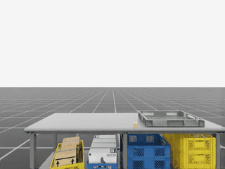

# ghostwalk

Put on a Meta Quest 3S and walk a Unitree G1 humanoid around Isaac Sim. You see through the robot's head in stereo, push the thumbstick to walk, and your hands, wrists and grip drive the robot's arms.

(ใส่แว่น Quest 3S แล้วบังคับหุ่น Unitree G1 ใน Isaac Sim ด้วยตาและมือของตัวเอง)

## Demo



*Headless capture (scripted input, no headset).* A Python client stands in for the headset: it backs the robot away from the table, walks it back toward the box, looks down, reaches with the right hand and closes the grip. These are the left-eye frames the PC streams to the headset, every 2nd frame played at 10 fps (about 2.5x faster than the sim runs). The box is not picked up in this clip; see [Known limits](#known-limits).

> TODO (owner): add a real headset clip here once recorded.

## How it works

```
Quest Browser (WebXR, JS)                    PC (Python, Isaac Lab, headless)
┌──────────────────────────┐  pose+input   ┌───────────────────────────────────┐
│ head pose, controller    │ ───────────▶ │ thumbstick -> velocity -> walk policy│
│ poses, trigger, sticks   │  JSON/WS      │ controller pose -> arm IK (+waist)   │
│                          │               │ trigger -> G1 hand open/close        │
│ draws left/right image   │ ◀─────────── │ virtual stereo camera at the head    │
│ per eye, reprojected     │  JPEG L/R/WS  │                                       │
└──────────────────────────┘               └───────────────────────────────────┘
```

- The headset page sends head and controller poses each frame. The PC renders two cameras (64 mm apart) at the robot's head and sends back two JPEGs, each tagged with the head pose it was rendered for.
- The page places each image in the world at that pose and lets the headset redraw it at its own refresh rate, so turning your head does not wait for the PC (reprojection).
- G1 has no neck, so the camera follows the robot's torso position (smoothed) and yaw plus your head rotation, instead of being bolted to the robot's head.

## Own code vs borrowed

**Written here:**

- `quest_web/`: WebXR page, input capture, per-eye display with reprojection, wire protocol.
- `sim/`: WebSocket server and wire format (`server.py`, `protocol.py`), WebXR to Isaac coordinate conversion (`coords.py`), head camera math and recenter (`camera_math.py`), controller to hand target / grip / stick mapping (`control_math.py`), and the teleop loop that ties it together (`teleop_app.py`).
- `sim/fake_sim.py`: a test-pattern source so the headset page can be tried without Isaac Sim.
- `tests/`, `quest_web/protocol.test.mjs`: unit tests for the above.

**Borrowed, not ours:**

- Isaac Sim (physics, rendering) and Isaac Lab (environment, Pink IK arm action, the G1 pick-and-place table scene).
- The G1 USD model and the pretrained walking policy (`agile_locomotion.pt`, trained with NVIDIA's AGILE framework).
- three.js (loaded from a CDN by the web page).

## Tested on

| | |
|---|---|
| Machine | RTX 5060 Laptop GPU (8 GB VRAM), Ryzen 7 250, 14 GiB RAM + 16 GiB swap, Ubuntu 24.04.5, driver 620.70.06 |
| Isaac Sim | 6.0.1-rc.7, source build (Python 3.12, torch 2.10.0+cu128) |
| Isaac Lab | 3.0.0 (`v3.0.0-beta2`) |
| Headset | Meta Quest 3S, Meta Quest Browser, USB-C cable. **Not yet tested on a real headset**; everything below was verified headless with scripted clients |

Measured numbers (this laptop, one G1, two 640x480 cameras, JPEG over WebSocket):

- **About 12 to 14 fps** stereo with the full scene (table, box, walking and arms), roughly 13 fps while walking. 15.2 fps without the table and with fixed arms; 16.9 fps in the bare milestone-0 spike (no JPEG, no WebSocket).
- **The sim runs at about 0.25 to 0.3x real time**: the robot walks in slow motion in wall-clock time.
- Peak RAM about 10.4 of 14.9 GiB and VRAM about 4.1 of 8 GiB in the milestone-0 run, no swap thrashing. See [`docs/milestone0.md`](docs/milestone0.md).
- Isaac Sim's own compatibility checker reports this machine as below minimum spec (VRAM 8.5 GB vs 10, RAM 16 GB vs 32). It runs anyway, but close Chrome and other memory-heavy apps first.

## Install

You need a working Isaac Sim 6.0.1 and Isaac Lab 3.0.0 (`v3.0.0-beta2`) built from source per NVIDIA's docs (Isaac Sim `./build.sh`, then Isaac Lab `./isaaclab.sh --install`, with `~/IsaacLab/_isaac_sim` pointing at the Isaac Sim build). This repo does not install them. Internet is needed on first run: the G1 model, walking policy and scene assets download from NVIDIA's asset server into `/tmp/Assets/` (about 174 MB).

The sim side runs inside Isaac Lab's Python, which already has numpy, Pillow and websockets. For the unit tests and `fake_sim` you need only a plain venv:

```bash
git clone <this repo> ghostwalk && cd ghostwalk
python3 -m venv .venv
.venv/bin/pip install -r requirements-dev.txt
```

For the headset: `sudo apt install adb`, enable developer mode on the Quest, connect it by USB-C and accept the debugging prompt in the headset.

## Run

Run everything from the repo root. WebXR needs a secure context, so the headset reaches the PC as `localhost` through `adb reverse` over the USB cable.

```bash
# 1. forward the headset's localhost ports to the PC
adb reverse tcp:8000 tcp:8000 && adb reverse tcp:8765 tcp:8765

# 2. serve the web page
python3 -m http.server 8000 --bind 127.0.0.1 -d quest_web

# 3. start the sim (headless; first start takes a minute or two)
~/IsaacLab/isaaclab.sh -p sim/teleop_app.py
```

Then open `http://localhost:8000` in Meta Quest Browser and press **Enter VR**. The sim prints `fps ... pelvis_z ...` every 5 seconds. Stop it with Ctrl-C.

To try the headset page without Isaac Sim, run `.venv/bin/python -m sim.fake_sim` in step 3: it sends a red "L" to the left eye and a blue "R" to the right and prints the poses it receives.

## Controls

| Input | Action |
|---|---|
| Left thumbstick | walk forward / back and strafe |
| Right thumbstick, x axis | turn |
| Controllers | the robot's hands follow their position, and the wrists follow their rotation |
| Trigger | close the hand (release to open) |
| Right A button | recenter the view (and re-zero wrist yaw) |
| Head | looks around inside the robot's camera |

Releasing the sticks stops the robot. So does losing the connection (within about half a second).

## How to test in the headset

Not done yet; this list is for the first session. Run `~/IsaacLab/isaaclab.sh -p sim/teleop_app.py` and connect as above.

1. **Pick up the box (first thing to try).** Walk to the table and try to lift the box. Keep your right hand raised while walking near the table: the default hand pose sits right above the box and sweeps it off if you walk backwards. Note whether the robot steps back when you reach down (it did headlessly).
2. **View and stereo.** You see the scene from the robot's head and it has depth. Turning or tilting your head rotates the view the right way and does not lag. Press right A: the view faces the robot's front again. The log shows fps at or above about 12.
3. **Arms, wrists and grip.** Reach forward, left/right, up/down: the robot's hand moves the same way. Turn and tilt a controller: the wrist turns the same way, and holding it naturally (pointing forward, upright) gives a grasp-ready hand. Squeeze the trigger: the hand closes. Put a controller down (tracking lost): the arm holds still without snapping. Reaching to the limit does not make the robot fall.
4. **Walking, stop, disconnect.** Left stick walks forward, back and sideways the right way; the right stick turns the right way. Releasing the sticks stops the robot. Pull the USB cable while walking: the robot stops within about 0.5 s without falling. Walking with an arm reached out does not make it fall. Also note how far the stick must move before the robot starts (about 0.3) and any yaw drift when walking straight.
5. **Sickness check.** Walk for 30 seconds: how dizzy do you feel? Vertical bob is damped and horizontal smoothing is light on purpose. Do not raise the x/y smoothing (`tau`) in `teleop_app.py` above about 0.05, or the eye trails into the robot's head. The view should not show the robot's own head while walking; looking down during a reach may show a shoulder.

## Known limits

- **Not tested in a headset yet.** Everything above was checked headless with scripted clients, including the controller to robot coordinate conventions. The headset may show sign or calibration mistakes.
- **Picking up the box has not worked headless.** In nine scripted attempts the box never lifted: while the arm reaches forward and down, the walking policy steps back about 0.2 m, out of the arm's 0.45 m reach. Whether a person can do it by feel is untested.
- **The box sits 5 cm from the table edge, and there is no box reset.** Arm swings near the table can knock it off; restart the app to get it back.
- **Slow and low frame rate.** About 12 to 14 fps and about 0.25 to 0.3x real time on this laptop (8 GB VRAM). The sim is below Isaac Sim's official minimum spec. Not tuned further.
- The robot slowly drifts backward and turns slightly when standing still (the walking policy, not the arms).
- The head offset (0.06, 0, 0.45 m in `torso_link`) is an estimate, not measured against the mesh.
- Image transport is plain JPEG over WebSocket, no WebRTC. Local, USB-only by design: the server binds `127.0.0.1`.
- Single user, Linux only. The `adb reverse` setup needs the USB cable.

## License

License: TBD.

NVIDIA's G1 asset and walking policy are not part of this repo and are not under its terms. They are fetched at runtime from NVIDIA's asset server and fall under the NVIDIA Isaac Sim Additional Software and Materials License. Do not redistribute them.
